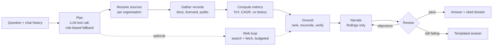

# Pallisade Research

A research assistant for investment analysts. You ask a question about a company, a country or a market. It answers in a few sentences and backs every figure with a citation: the firm's own documents first, then licensed data, then public sources and the open web.

The language model plans the query and writes the prose, but it never supplies the facts. Facts come from a deterministic pipeline that tracks provenance. Each draft answer is then checked against that evidence before anyone sees it. If a draft still fails after two rewrites, the analyst gets a plain templated summary of the findings instead.

## What it does

- **Research.** A multi-turn chat. Follow-ups such as "what about its margins?" resolve against the conversation, and every answer comes with a dossier of cited records. A "deep dive" toggle lets a bounded web-research loop gather more sources.
- **Debate.** A bull-versus-bear and risk debate on a ticker, run on the worker and streamed live as a transcript. It is built on the [TradingAgents](https://github.com/TauricResearch/TradingAgents) multi-agent graph (see [Credits](#credits-and-license)), with the analysts given a tool that searches the firm's own documents first.
- **Documents.** Upload PDFs (native text or scanned) and spreadsheets. The worker parses, chunks and embeds them, and they become the top-priority source for that organisation.
- **Connectors.** Each organisation chooses its data sources: bring-your-own-key licensed providers, holdings, MCP servers and web search. Credentials are encrypted at rest.
- **Watchlist, dashboard, artefacts.** Quotes and sparklines for tracked names (via yfinance), plus a library of past research and debate outputs. Research conversations and debates export to PDF.
- **Memo checker (API only).** Pulls every numeric figure out of an analyst's memo, finds the passage in the firm's documents that should back it, and marks each figure as `match`, `mismatch`, `stale` or `unsupported`. Its UI page was removed during a UI clean-up. The endpoint and worker job remain.

## How it works

One research turn:



1. **Plan.** Claude is forced into a `plan_research` tool call. It turns the latest message into a standalone question, an exchange-qualified ticker (`NPN.JO`, `7203.T`) or a non-equity entity (a country, an FX pair, an index), and a list of data capabilities to fetch. If the model is unavailable, a keyword planner takes over.
2. **Resolve sources.** `pallisade_connections.resolver` builds the organisation's source set. It combines the built-in public sources, the organisation's own connections (credentials decrypted per request), and its document corpus if any documents are ready. Sources are ordered by tier: 1 for the firm's documents, 2 for licensed bring-your-own-key data, 3 for public data.
3. **Gather.** Sources are queried in tier order. The first source that returns data for a capability claims it, and lower tiers don't overwrite it. A source that errors is listed as unavailable rather than failing the turn. Every value is a `Record` with a `Provenance`: source, locator, as-of date, tier and liveness.
4. **Compute.** Trend questions bring in time series. `metrics/compute.py` derives year-on-year growth, CAGR and value-versus-history in plain Python. Each derived record stores its operation, its input record IDs and a human-readable formula.
5. **Ground.** News and research articles are ranked against the question, keeping the top few per capability. `reconcile` groups records by key and value. Sources that agree merge into one claim citing all of them, and sources that disagree become separate claims. `verify` drops any claim whose records don't resolve, and records a coverage gap for each requested capability that nothing covered.
6. **Narrate and review.** The narrator sees only the grounded claims. Its draft then goes through three checks:
   - every number in the draft must appear in the evidence;
   - every derived figure is recomputed from its cited inputs and must match within 0.01;
   - a separate auditor call, forced into a `report_issues` tool, flags unsupported statements, misattributed sources and wrong direction (a "rise" that was a fall).

   Objections go back to the narrator for up to two rewrites. If the auditor itself fails, the turn fails closed to the template. The API reports which path produced the text: `verified`, `regenerated`, `fallback` or `template`.

Documents take a separate path through the worker:

```
upload → parse_document → embed_document → pgvector
```

Parsing uses pypdf for native-text PDFs. If a PDF yields under 100 characters, it is treated as a scan: pages are rendered with pypdfium2 and transcribed by Claude vision, a few pages at a time. Spreadsheets are read sheet by sheet. Chunks are sentence-packed windows of about 500 tokens with about 80 tokens of overlap. They are embedded with Voyage `voyage-3` (1024 dimensions) and stored under an HNSW cosine index. Research retrieval is scoped to one organisation and applies a similarity floor, so a weakly related passage (for example, one about the wrong company) isn't cited.

## Engineering notes

Decisions worth looking at, with the files they live in:

- **Grounding is enforced in code, not asked for in a prompt.** The models can choose what to fetch and how to phrase the answer, but the numbers shown come from `Record`s. The review step checks that mechanically (`pallisade_research/answer_review.py`). The number check ignores sign on purpose. Narration says "fell 12.5%" while the record says `-12.5`, so direction is left to the auditor and the two checks don't overlap.
- **No LLM arithmetic.** Growth rates and ratios are computed in Python, stored with their formula, and recomputed during review (`pallisade_research/metrics/compute.py`, `unverified_derivations`). Any derivation that can't be reproduced is rejected.
- **The web loop gathers; it doesn't answer.** The model may only call `web_search` and `fetch_url`, within a fixed budget (1 search and 3 fetches by default, 3 and 8 on a deep dive). Fetched passages become ordinary tier-3 records, so they go through the same grounding and review as everything else (`pallisade_research/web/loop.py`).
- **Model-chosen URLs are treated as hostile.** `fetch_url` only follows http and https. It resolves the host and refuses loopback, private, link-local, reserved and multicast addresses, and checks every redirect hop again. PDF rendering blocks every external resource except `data:` URIs (`pallisade_research/web/fetch.py`, `web/api/services/pdf/render.py`).
- **The job queue is Postgres itself.** Workers claim jobs with `SELECT … FOR UPDATE SKIP LOCKED` and send heartbeats from a side thread. A reaper requeues jobs whose heartbeat goes stale. Ordinary errors retry up to a limit, while a `HardError` fails the job immediately (`pallisade_worker/loop.py`).
- **A debate can't run twice.** A requeued debate job could otherwise repeat the argument and pay for the LLM calls again. The runner claims the run with a compare-and-set from `queued` to `running`, and finalises an orphaned run as failed instead of re-entering it (`pallisade_worker/debate_runner.py`).
- **Live streaming and replay are the same query.** The worker appends debate events to an append-only `run_events` table keyed by `(run_id, seq)`. The SSE endpoint tails that table from a cursor and resumes from `Last-Event-ID`, so reopening a finished debate replays the same events. Turn extraction from LangGraph state is a pure function with its own tests (`pallisade_core/runs/`).
- **Per-run config on top of a global.** TradingAgents keeps its config in a module-level global. The fork adds a `ContextVar` override layer, so concurrent debates for different organisations can't overwrite each other's settings (`tradingagents/dataflows/config.py`).
- **Tests don't need real model keys.** The Anthropic client, embedder, search and fetch are all injected. A deterministic hash-based embedder stands in for Voyage, and DB tests run against a real pgvector container, each test inside a rolled-back savepoint.

## Stack

- **Backend:** Python 3.10+, FastAPI, SQLAlchemy 2, Alembic, Pydantic settings.
- **Database:** PostgreSQL 16 with pgvector.
- **Models:** Anthropic Claude (planning, narration, review, OCR, memo checks), Voyage AI embeddings, LangGraph/LangChain for the debate graph.
- **Data:** yfinance, EODHD, the World Bank API, Tavily for web search, and MCP servers over streamable HTTP.
- **Frontend:** Next.js 15, React 19, Tailwind CSS 4.
- **PDF export:** WeasyPrint and Jinja2.

## Layout

```
pallisade_research/     cited-answer engine: planner, sources, compute, reconcile, verify, review, web loop
pallisade_connections/  per-org source resolver, connectors (built-in, MCP), credential encryption
pallisade_core/         shared infra: auth, db, settings, documents + parsers, RAG, runs + events, memo checks
pallisade_worker/       durable job worker (parse, embed, run_debate, check_memo)
tradingagents/          fork of TauricResearch/TradingAgents: the debate/analysis graph
web/api/                FastAPI app (web.api.main:app), PDF export
web/ui/                 Next.js UI
alembic/                database migrations
tests/                  pytest suite
```

## Running it locally

Requirements: Python 3.10+ (CI uses 3.11), Node 18+, Docker (or a local PostgreSQL with `pgvector`). PDF export needs Pango: run `brew install pango` on macOS, or install `libpango-1.0-0 libpangoft2-1.0-0` on Debian or Ubuntu.

```bash
# 1. Python env (the API's extra deps, e.g. WeasyPrint, live in web/api/requirements.txt)
python3 -m venv .venv && source .venv/bin/activate
pip install -e ".[dev]" -r web/api/requirements.txt

# 2. Config: copy the example and fill in the required keys
cp .env.example .env
#   required: PALLISADE_DATABASE_URL, PALLISADE_SESSION_SECRET,
#             PALLISADE_STORAGE_SIGNING_KEY, PALLISADE_ANTHROPIC_API_KEY,
#             PALLISADE_VOYAGE_API_KEY
#   optional: PALLISADE_CONNECTIONS_ENC_KEY (needed to save connector credentials),
#             WEB_SEARCH_API_KEY (Tavily; enables the web-research loop),
#             EODHD_API_KEY (EODHD news, fundamentals and markets)

# 3. Database (Postgres 16 + pgvector; credentials match .env.example)
docker compose up -d pallisade-db
alembic upgrade head

# 4. Run each in its own shell, with .env exported into the environment
set -a; source .env; set +a
uvicorn web.api.main:app --reload --port 8000     # API
python -m pallisade_worker                        # worker
cd web/ui && npm install && npm run dev           # UI
```

Export the variables with `set -a` as shown, not a plain `source .env`. The `PALLISADE_*` settings are also read from `.env` directly, but `WEB_SEARCH_API_KEY` and `EODHD_API_KEY` are read from the process environment only.

The UI proxies `/api/*` to the API (set `NEXT_PUBLIC_API_URL` to change the target). It starts on port 3000, or on the next free port if 3000 is taken. The API's CORS allow-list covers 3000 and 3001. On macOS, if WeasyPrint can't find Pango, set `DYLD_FALLBACK_LIBRARY_PATH=/opt/homebrew/lib` before starting the API.

## Tests

```bash
pytest tests/pallisade_research   # fast, DB-free: engine, review, compute, web loop, research API
pytest                            # full suite; DB-backed tests start a pgvector container via testcontainers (needs Docker)
```

The settings loader still needs the required keys, but dummy values are fine. The CI workflow uses placeholder values. The only test that calls a real model is one inherited from upstream, and it skips unless `DEEPSEEK_API_KEY` is set.

A handful of tests inherited from upstream TradingAgents exercise its command-line interface, which wasn't carried into this repo. Those tests skip themselves with that reason.

## Status

This is a working prototype, not a hardened product:

- **Login is disabled.** Every request without a session cookie resolves to a default demo account (`web/api/deps.py`). Per-user and per-organisation scoping is implemented and tested, but in practice everything runs as one account.
- **The rule-based planner only recognises a few hard-coded tickers.** It is the fallback path; the LLM planner handles everything else.
- **The memo checker has no UI page at the moment.**
- **The `Dockerfile` and the non-database services in `docker-compose.yml` are left over from the original monorepo,** and their entrypoint no longer exists. Use the commands above. Only the `pallisade-db` service is current.

Nothing here is financial, investment or trading advice.

## Credits and license

`tradingagents/` is a fork of [TradingAgents](https://github.com/TauricResearch/TradingAgents) by Tauric Research (Yijia Xiao, Edward Sun, Di Luo and Wei Wang; [arXiv:2412.20138](https://arxiv.org/abs/2412.20138)), taken in May 2026 and released under the Apache License 2.0. The multi-agent graph, the analyst, researcher, trader and risk agents, the LLM client layer and most of the market-data fetchers are their work. Files changed from the original carry a notice on their first line.

Changes made to the fork here:

- a `search_org_documents` tool that gives the analysts the firm's own documents as their first source;
- per-run config through a `ContextVar`, and an analysts-only mode for the graph;
- South African coverage: Moneyweb and Google News RSS fetchers, Alpha Vantage falling back to the next vendor when a symbol (such as a JSE listing) returns nothing, and ticker disambiguation for social posts that mention short, word-like symbols;
- prompt and schema changes: an opening bull turn that doesn't invent a bear argument, a shared "house style" (institutional voice, no invented figures, no sizing or execution instructions), and a one-line takeaway on each report;
- a reworked research plan (conviction, thesis, catalysts, falsifiers), with the trader node turned into a pre-mortem on that plan instead of issuing a trade.

The rest of the application was written for this project: `pallisade_research`, `pallisade_connections`, `pallisade_core`, `pallisade_worker`, `web`, the migrations, the tests under `tests/pallisade*`, and the prompt-voice tests at the top level of `tests/`. Other top-level tests, `main.py` and the `Dockerfile` come from upstream.

The repository is distributed under the Apache License 2.0; see [LICENSE](LICENSE).
